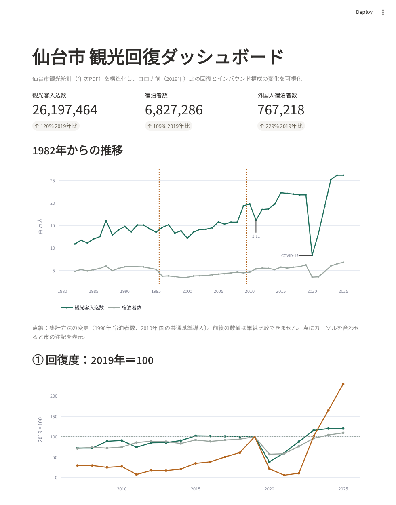
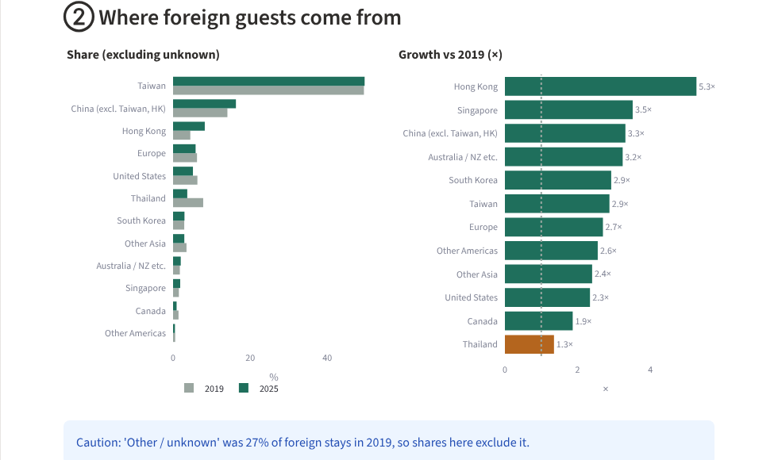

# 仙台市 観光回復ダッシュボード / Sendai Tourism Recovery Dashboard

**年ごとにバラバラに公開される行政統計を、検証済みの時系列データと意思決定に使えるダッシュボードに変える。**
Turning a city's year-by-year statistics reports into one validated time series and a dashboard a decision-maker can use.



## 課題 / Problem
仙台市の観光統計は年1回、1冊ずつ（PDF・Excel）公開されています。国・地域別の外国人宿泊者や居住地別の構成など有用なデータがある一方、各版がそれぞれ直近数年分のみを掲載しているため、長期で比較するには毎年の報告書をつなぎ合わせ、版ごとの数値の食い違いを確認する必要があります。

Sendai publishes its tourism statistics once a year as a separate report (PDF and Excel). Each edition covers only the last few years, so building a long, consistent series means stitching 15 reports together and checking them against each other.

**想定ユーザー:** 市の観光担当者。「どの市場に次年度の予算を重点配分すべきか」を根拠をもって説明したい。
**Persona:** a city tourism planner who must justify where next year's promotion budget goes.

## 問い / Questions
1. コロナ前（2019年）の水準にどこまで回復したか / How far has tourism recovered against 2019?
2. インバウンドの国・地域構成はどう変わったか / How has the mix of foreign markets changed?
3. 宿泊客はどこから来ているか / Where do overnight guests live?

詳細は [docs/requirements.md](docs/requirements.md)（ペルソナ、ユーザーストーリー、KPI定義、スコープ外）。

## アプローチ / Approach
1. **抽出 / Extract:** 15冊の年次報告書（平成23年版〜令和7年版）のPDFから表をPythonで構造化（`scripts/extract.py`）。1982年からの長期推移表も取り込み（`scripts/longrun.py`）。
2. **検証 / Validate:** 各表の合計値と照合し、不一致があれば処理を停止。報告書間で重複する年の数値を突き合わせ（改訂は `revisions.csv`）、記載された前年比も実数から再計算して照合（誤記は `quality_flags.csv`）。
   Every table is checked against its published total; any mismatch stops the run. Overlapping years across reports are compared, and every printed year-on-year % is recalculated from the counts. Revisions and source typos are logged, never silently fixed.
   さらに、市が公開しているExcel版（`scripts/crosscheck_excel.py`）と長期推移表の3系統で照合。 / Every value is also checked against the city's Excel versions and the 1982– trend series.
3. **可視化 / Visualise:** Streamlitで日英切り替え可能なダッシュボードを構築（`app/dashboard.py`）。
4. **自動更新 / Automate:** GitHub Actionsで毎月データを再取得・再検証。

## 主な結果 / Key findings
- 2025年は入込数・宿泊者数とも **1982年以降の最高値** / 2025 is the highest year since records began in 1982.
- 2019年比：入込数 **120%**（2024年から横ばい）、宿泊者数 **109%**、外国人宿泊者数 **229%** / Against 2019: visits 120% (flat), overnight stays 109%, foreign guests 229%.
- 作並を含む宮城地区の宿泊者はコロナ前から長期減少（2007年30.4万→2025年15.2万）/ Stays in the Sakunami area have been falling since long before COVID (304k in 2007 → 152k in 2025).
- 宿泊客の宮城県内比率は **31.5%→14.5%**（2010→2025）/ Guests from within Miyagi fell from 31.5% to 14.5% (2010→2025).
- 宿泊客の **5人に1人が海外**（12.4%→21.6%）。台湾は一貫して約半分。タイは **1.3倍** にとどまる / One in five guests now comes from overseas; Taiwan stays at about half of foreign guests; Thailand grew only 1.3×.

全文は [docs/insights.md](docs/insights.md)。



## 品質 / Data quality
- 15冊の報告書間で重複する年の数値がすべて一致（改訂0件）。Excel版とも292項目すべて一致。長期推移表とも重複19年すべて一致 / All overlapping years agree across the 15 reports (0 revisions); all 292 values match the city's Excel files; the 1982– series matches for all 19 overlapping years.
- 原資料の前年比の誤記を5件検出（例：令和7年版の2024年入込数 記載131.3%→実数から103.8%）/ Found 5 errors in printed year-on-year % in the source (e.g. the 2025 edition prints 2024 visitors as 131.3%; the counts give 103.8%).
- 1996年・2010年に集計方法の変更あり。長期比較は参考値 / Counting methods changed in 1996 and 2010; long-run comparisons across them are indicative.
- 2019年は外国人の27%が「その他・不明」のため、構成比は不明分を除いて比較 / 27% of 2019 foreign stays are "unknown", so shares exclude it.
- 記述統計のみ。因果は主張しない / Descriptive only; no causal claims.

各項目の定義は [docs/data-dictionary.md](docs/data-dictionary.md)、設計判断は [docs/decisions.md](docs/decisions.md)、今後の計画は [docs/roadmap.md](docs/roadmap.md)。

## 実行方法 / Run it
```bash
pip install -r requirements.txt
python scripts/download.py --all   # 仙台市サイトからPDF・Excel・長期推移表を取得
python scripts/extract.py          # PDFから抽出・検証 → data/processed/*.csv
python scripts/longrun.py          # 1982年からの長期推移を取り込み、報告書と照合
python scripts/crosscheck_excel.py # Excel版と照合
streamlit run app/dashboard.py
```

## 出典 / Source
仙台市観光戦略課「仙台市観光統計基礎データ」（平成23年〜令和7年）および「観光客入込数・宿泊者数の推移」を加工して作成。
https://www.city.sendai.jp/kankokikaku/toukei/toukei.html
