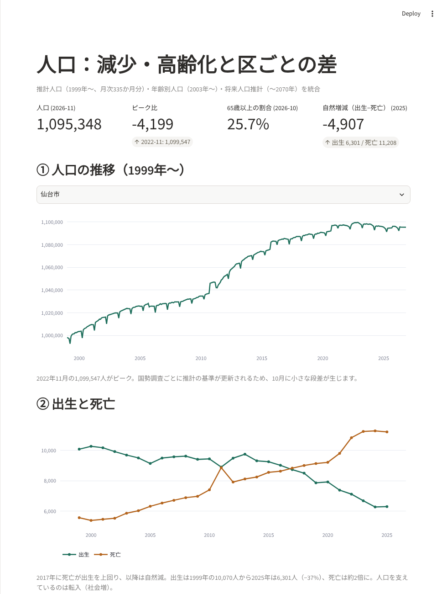

# 仙台市 都市ダッシュボード / Sendai City Dashboard

**仙台市が年ごと・月ごとにバラバラに公開している統計を集め、相互に検証し、意思決定に使える形で可視化する。**
Collecting the statistics the City of Sendai publishes file by file, checking them against each other, and turning them into a dashboard a decision-maker can use.

**▶ Live dashboard:** (ここにStreamlitのURL / your Streamlit URL here)



## ページ / Pages

| ページ / Page | 問い / Question | データ / Data |
|---|---|---|
| 👥 人口 / Population | どの区で人口減少・高齢化が進み、2070年までにどう変わるか / Which wards are shrinking and ageing, and how does that change by 2070? | 推計人口 335か月分（1999–）、年齢別人口（2003–）、将来人口推計（–2070） |
| 🚇 交通 / Mobility | コロナ後、市民の移動と空の玄関口はどこまで戻ったか / How far have travel in the city and through the airport come back since COVID? | 市営バス・地下鉄（2006年度–）、JR各駅・地下鉄駅別（2007年度–）、仙台空港（2007–） |
| 🧳 観光 / Tourism | コロナ前からどこまで回復し、インバウンドの構成はどう変わったか / How far has tourism recovered, and how has the mix of foreign visitors changed? | 観光統計 15冊（2007–）、長期推移（1982–） |

## 課題 / Problem
市の統計は1か月・1年ごとに別々のファイル（PDF・Excel）で公開されています。各ファイルは直近の数値しか載せておらず、年によって表のレイアウトも異なります。長期の推移や区ごとの比較を見るには、数百のファイルをつなぎ合わせ、ファイル間の食い違いを確認する必要があります。

The city publishes each month or year as a separate file, each covering only recent figures, with layouts that change over the years. Seeing long-run trends or comparing wards means stitching hundreds of files together and checking them against each other.

**想定ユーザー:** 市の企画担当者。人口や観光の変化を、根拠のある数字で説明したい。
**Persona:** a city planner who has to explain changes in population and tourism with numbers that hold up.

## 主な結果 / Key findings

**人口 / Population** ([全文 / full](docs/insights_population.md))
- 人口は2022年11月がピーク（1,099,547人）。2017年から自然減で、出生は1999年比 **−37%** / Population peaked in Nov 2022; deaths have outnumbered births since 2017, and births are down 37% since 1999.
- 泉区は2003年に最も若い区（65歳以上12.0%）→ 現在は最も高齢（30.2%）。2070年には人口が2020年の **52%** の見込み / Izumi went from youngest to oldest ward and is projected to shrink to 52% of its 2020 size by 2070.

**交通 / Mobility** ([全文 / full](docs/insights_mobility.md))
- 地下鉄は2024年度に過去最多（2019年度比102%）、市営バスはコロナ前から長期減少（2014年度比77%）/ The subway set a record in FY2024; city buses are at 77% of FY2014.
- 仙台空港は2025年に過去最多の397万人、国際線は2019年比 **160%** / Sendai Airport had its busiest year in 2025; international passengers are at 160% of 2019.

**観光 / Tourism** ([全文 / full](docs/insights.md))
- 2025年は入込数・宿泊者数とも **1982年以降の最高値**。外国人宿泊者数は2019年比 **229%** / 2025 is the highest year since 1982; foreign guests are at 229% of 2019.
- 作並を含む宮城地区の宿泊者はコロナ前から長期減少（2007年30.4万→2025年15.2万）/ Stays in the Sakunami area have been falling since long before COVID.

## アプローチ / Approach
1. **収集 / Collect:** 市の索引ページを読み、リンクされたファイルをすべて取得（ファイル名の不規則さに依存しない）/ Read the city's own index pages and fetch every linked file, so irregular file names don't matter.
2. **抽出 / Extract:** 列は位置ではなく構造で特定（総数＝男＋女、自然増加数＝出生−死亡）。レイアウトが変わっても読める / Columns are found by structure, not position (total = men + women; natural change = births − deaths), so layout changes don't break the parser.
3. **検証 / Validate:** 合計値・ファイル間・Excel版・市の年次表と照合。食い違いがあれば処理を停止。原資料の誤記は修正せず記録 / Every figure is checked against published totals, other files, the Excel versions and the city's yearly tables. Any mismatch stops the run; errors in the source are logged, never silently fixed.
4. **可視化 / Visualise:** Streamlit、日英切り替え / Streamlit, Japanese and English.
5. **自動更新 / Automate:** GitHub Actionsで毎月再取得・再検証 / Re-fetched and re-checked monthly by GitHub Actions.

## 品質 / Data quality
- 観光：15冊の報告書・Excel版（292項目）・長期推移表（重複19年）がすべて一致 / Tourism: 15 reports, their Excel versions (292 values) and the long-run series all agree.
- 人口：335か月すべてで区の合計＝市、総数＝男＋女。月別出生・死亡の年合計が市の年次表と完全一致 / Population: every month checked; yearly births and deaths match the city's own table exactly.
- 交通：372件の検証で説明のつかない不一致0件。15冊の統計書の重複年を照合し、改訂1件を記録 / Mobility: 372 checks, none unexplained; overlapping years compared across 15 yearbook editions, one revision logged.
- 原資料の誤記を **10件** 検出・記録（観光5件、人口4件、交通1件）/ **10 errors** found in the source and logged (tourism 5, population 4, mobility 1).

詳細 / Details: [data dictionary](docs/data-dictionary.md) · [decisions](docs/decisions.md) · [roadmap](docs/roadmap.md) · [requirements](docs/requirements.md)

## 実行方法 / Run it
```bash
pip install -r requirements.txt

# 観光 / tourism
python scripts/download.py --all     # PDF・Excel・長期推移表
python scripts/extract.py
python scripts/longrun.py
python scripts/crosscheck_excel.py

# 人口 / population
python scripts/population_download.py   # 約400ファイル、5分程度 / ~400 files, about 5 minutes
python scripts/population_extract.py

# 交通 / mobility
python scripts/mobility_download.py     # 統計書15冊・交通局・国交省 / yearbook, transport bureau, ministry
python scripts/mobility_extract.py

streamlit run app/dashboard.py
```

## 出典 / Sources
- 仙台市観光戦略課「仙台市観光統計基礎データ」（平成23年〜令和7年）、「観光客入込数・宿泊者数の推移」
  https://www.city.sendai.jp/kankokikaku/toukei/toukei.html
- 仙台市「推計人口」「住民基本台帳による区・年齢（5歳階級）別人口」「仙台市の将来人口推計（令和4年推計）」
  https://www.city.sendai.jp/chosatoke/shise/toke/index.html
- 仙台市統計書「交通・運輸・通信」（平成23年版〜令和7年版） https://www.city.sendai.jp/chosatoke/shise/toke/tokesho/index.html
- 仙台市交通局「乗車人員一覧」 https://www.kotsu.city.sendai.jp/subway/joushajinin/
- 国土交通省「空港管理状況調書」 https://www.mlit.go.jp/koku/15_bf_000185.html

いずれも作成者が加工して作成。将来推計は仙台市によるもの。 / All processed by the author; projections are the city's.
